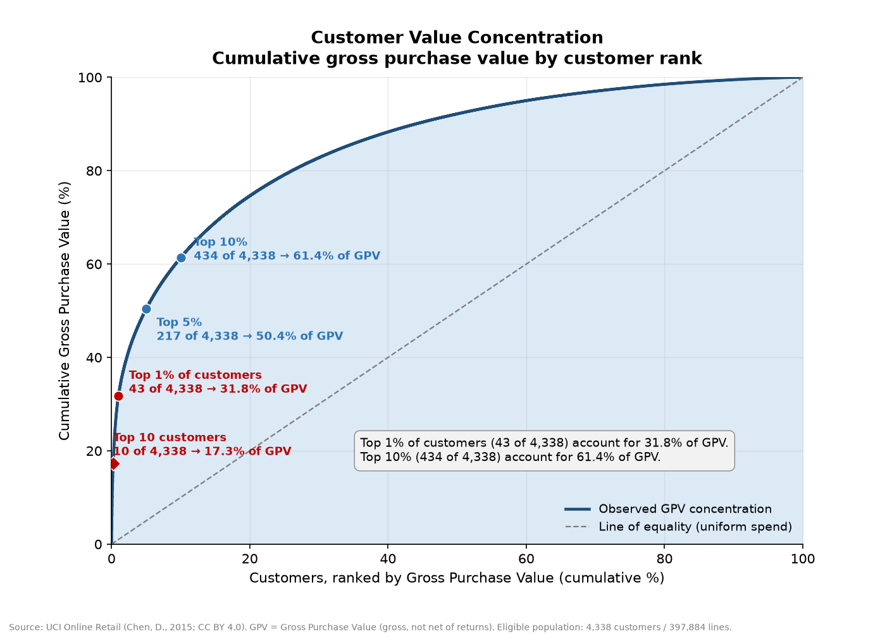
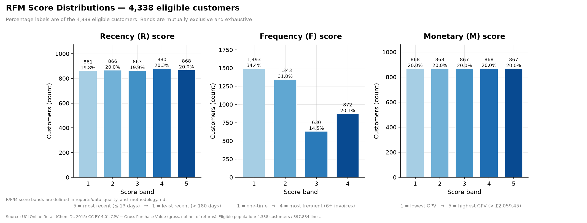
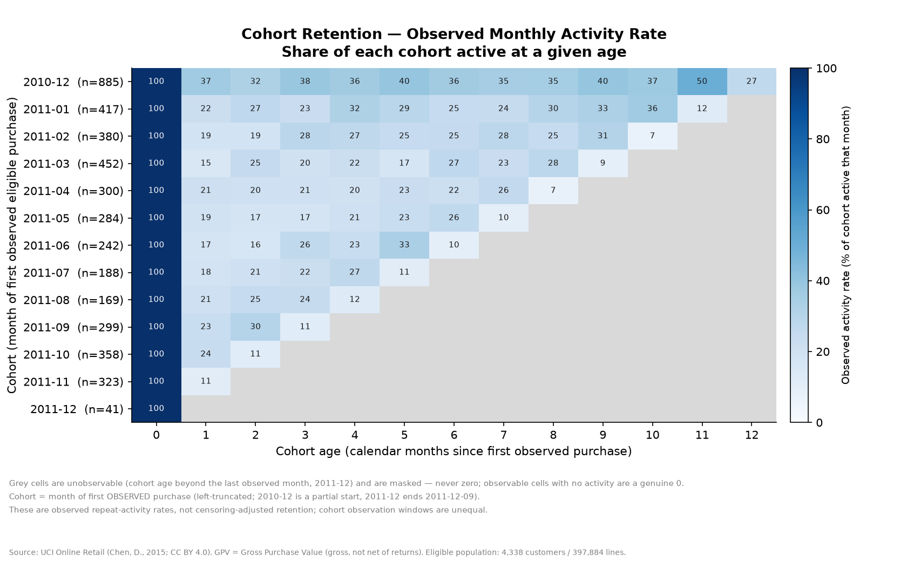
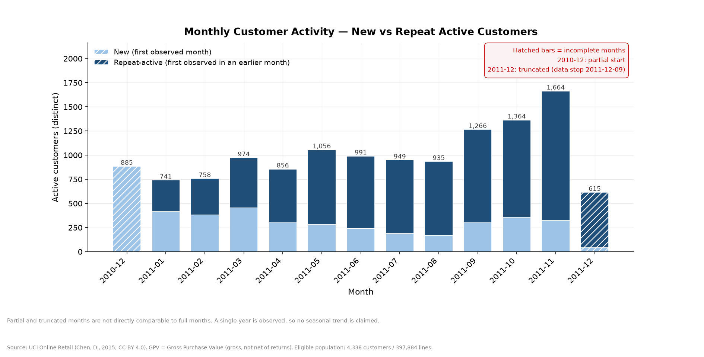

# Customer Retention, Repeat Purchasing, RFM & Cohort Analysis — Final Business Report

**Dataset:** UCI Online Retail (dataset 352) — Chen, D. (2015), UCI Machine Learning Repository, CC BY 4.0.
**Observation window:** 2010-12-01 08:26:00 → 2011-12-09 12:50:00 (≈12 months).
**Recency reference date:** 2011-12-10 (the day after the last observed transaction).
**Analysis population:** eligible purchase lines with a known customer (`CustomerID` not null).
**Monetary measure:** Gross Purchase Value (GPV) in GBP — gross, not net of returns (see §3, §9).

---

## 1. Executive Summary

Across approximately twelve months of transactions, **397,884 eligible purchase lines** from
**18,532 invoices** and **4,338 identified customers** generated **£8,911,407.90** in Gross
Purchase Value (GPV). Under the project's eligibility rules, line-level and customer-level GPV
reconcile exactly (difference **£0.00**).

- **Repeat purchasing carries almost all value.** **2,845 customers (65.58%)** purchased in two
  or more distinct invoices and accounted for **£8,295,096.17 (93.08% of GPV)**. The remaining
  **1,493 customers (34.42%)** were one-time buyers contributing **£616,311.73 (6.92% of GPV)**.
- **Value is highly concentrated.** The **top 1% of customers (43 of 4,338)** accounted for
  **£2,831,634.13 (31.78%)** of GPV; the **top 5% (217)** for **£4,489,400.21 (50.38%)**; the
  **top 10% (434)** for **£5,469,382.46 (61.38%)**. The **top 10 customers alone** accounted for
  **£1,538,276.65 (17.26%)**.
- **Recency is spread across the customer base.** **40.3% of customers (1,748)** purchased within
  33 days of the reference date, while **19.85% (861)** last purchased more than 180 days earlier.
  Long recency within a finite window is **not** proof of churn (see §7, §9).
- **Repeat activity generally rises through the year**, and **November 2011** was the busiest
  observed month (**£1,161,817.38**, **2,657** invoices, **1,664** active customers). This is a
  **single-year observation** and is **not** presented as a stable seasonal pattern.
- **Interpret with care:** about **25% of raw rows (135,080)** have no `CustomerID` and are
  excluded from customer-level metrics; cancellations and returns are **not netted**; and exact
  duplicates were **flagged, not deleted** (a sensitivity view lowers GPV by **£24,199.01**, or
  **0.2716%**).

---

## 2. Business Questions and Scope

### Questions this analysis addresses

1. **How much repeat purchasing is there** among identified customers, and how does it split by
   customer count and by GPV?
2. **How concentrated is customer value**, and how much of GPV comes from the top customers?
3. **How are customers distributed across Recency, Frequency and Monetary (RFM) bands**, using
   the documented scoring rules?
4. **What does observed repeat activity look like by acquisition cohort and age**, given the
   limits of a twelve-month window?
5. **How do new versus repeat-active customers vary by month**, and which months are incomplete?

### Questions this analysis does *not* answer

- **Net revenue / profitability.** All monetary values are **gross**; cancellations and returns
  are not reliably matched to originals and are not netted (see §3, §9).
- **Permanent churn or lifetime value.** The window is ~12 months with partial first/last months;
  absence of activity after a date can simply be unobserved.
- **Causal impact of any action.** No intervention is present in the data; findings are
  descriptive associations only.
- **Seasonality.** Only one partial year is observed; a single peak cannot establish a repeating
  seasonal cycle.
- **The ~25% of transactions without a customer ID**, including the **3,710** invoices that are
  entirely unattributable.

---

## 3. Data and Methodology

**Source and scope.** The raw archive `data/raw/online_retail.zip` (UCI Online Retail, CC BY 4.0)
is preserved unchanged and read in memory. It contains **541,909** rows, **25,900** distinct
invoices and **4,372** distinct non-null customers. All figures in this report are aggregates
derived from these data.

**Eligible purchase line.** A line is eligible when it is *not* a cancellation (`InvoiceNo` does
not start with `C`), has a non-null `CustomerID`, `Quantity > 0`, `UnitPrice > 0`, and falls within
the observed date range. This yields **397,884 eligible lines**, **18,532 eligible invoices** and
**4,338 eligible customers**.

**Gross Purchase Value (GPV).** For each eligible line, GPV = `Quantity × UnitPrice`, summed per
customer. GPV is **gross**: cancellations and returns are **not** netted because reliable
cancellation-to-original matching was not established from the available fields. GPV is therefore
**not net revenue**.

**Repeat-purchase logic.** Frequency is the number of **distinct eligible invoices** per customer.
A customer is a **repeat buyer** if they have **≥2** eligible invoices, and a **one-time buyer** if
they have exactly one.

**RFM scoring** (reference date 2011-12-10; equal boundary values share a score; bands are mutually
exclusive and exhaustive):

- **Recency (R, 5 bands)** — calendar days since the last eligible purchase: `≤13`, `14–33`,
  `34–72`, `73–180`, `>180` (scores 5 → 1, most to least recent).
- **Frequency (F, 4 ordinal bands)** — `1`, `2–3`, `4–5`, `≥6` invoices (scores 1 → 4).
- **Monetary (M, 5 bands)** — GPV `≤£250.15`, `≤£490.22`, `≤£942.26`, `≤£2,059.45`, `>£2,059.45`
  (scores 1 → 5).

**Cohort methodology.** A customer's cohort is the **month of their first observed eligible
purchase** (left-truncated — it may not be their true first-ever purchase). Cohort **age** is the
calendar-month difference between the activity month and the cohort month. A cohort-age cell is
**observable** only when cohort + age ≤ the last observed month (2011-12); unobservable/future
cells are **NA**, never zero. Reported rates are **observed repeat-activity rates** for specific
ages, **not** censoring-adjusted retention.

**Validation.** All definitions are implemented in read-only SQL (`sql/01`–`06`) and rendered by
`scripts/create_visualizations.py`. Reported totals reconcile across line-level and customer-level
aggregations (GPV difference £0.00), cohort sizes sum to 4,338, age-0 activity is 100% for every
cohort, and the duplicate sensitivity is limited to the metrics explicitly tested.

---

## 4. Customer Retention and Repeat Purchasing

Of **4,338** eligible customers, **2,845 (65.58%)** were repeat buyers and **1,493 (34.42%)** were
one-time buyers. Repeat buyers produced the large majority of value.

| Segment | Customers | % of customers | Eligible invoices | Total GPV (£) | % of GPV | Avg. GPV / customer (£) | Avg. GPV / invoice (£) |
|---|---:|---:|---:|---:|---:|---:|---:|
| One-time (1 invoice) | 1,493 | 34.42% | 1,493 | 616,311.73 | 6.92% | 412.80 | 412.80 |
| Repeat (≥2 invoices) | 2,845 | 65.58% | 17,039 | 8,295,096.17 | 93.08% | 2,915.68 | 486.83 |
| **All eligible** | **4,338** | **100%** | **18,532** | **8,911,407.90** | **100%** | **2,054.27** | **480.87** |

Frequency distribution (share of customers):

| Invoices | 1 | 2 | 3 | 4 | 5 | 6+ |
|---|---:|---:|---:|---:|---:|---:|
| Customers | 1,493 | 835 | 508 | 388 | 242 | 872 |
| % of customers | 34.42% | 19.25% | 11.71% | 8.94% | 5.58% | 20.10% |

Frequency and monetary spread: median frequency **2** invoices (p75 **5**, p90 **9**, max **209**);
customer GPV median **£674.49** vs mean **£2,054.27** (p25 **£307.40**, p75 **£1,661.84**,
max **£280,206.02**). The gap between median and mean reflects a long right tail.

**Observed pattern:** a large one-time group (34.42%) and a sizable frequent group (20.10% with 6+
invoices), with repeat buyers accounting for **93.08%** of GPV. Since the window is finite and
right-truncated, "one-time" describes **observed** behaviour within the window only.

---

## 5. Customer Value Concentration

Ranking customers by GPV shows strong concentration:

| Segment | Customers | GPV (£) | % of total GPV |
|---|---:|---:|---:|
| Top 1% | 43 | 2,831,634.13 | 31.78% |
| Top 5% | 217 | 4,489,400.21 | 50.38% |
| Top 10% | 434 | 5,469,382.46 | 61.38% |
| Top 10 customers | 10 | 1,538,276.65 | 17.26% |

The top decile of customers generates **61.38%** of total GPV, and just **43 customers (top 1%)**
generate **31.78%**. This concentration is the clearest single signal in the analysis.



*Figure 01 — Cumulative GPV by customer rank (customers ordered by GPV, highest first) against a
line of equality. Points mark the top 1%, 5% and 10% segments and the top 10 customers. GPV is
gross and not net of returns; the eligible population is 4,338 customers / £8,911,407.90.*

---

## 6. RFM Segmentation

All **4,338** customers were scored with the documented bands; there were **no missing scores**,
all scores were in range, and Monetary was positive for every customer. Distribution by band:

| Score | R — Recency | F — Frequency | M — Monetary |
|---|---:|---:|---:|
| 1 | 861 | 1,493 | 868 |
| 2 | 866 | 1,343 | 868 |
| 3 | 863 | 630 | 867 |
| 4 | 880 | 872 | 868 |
| 5 | 868 | — | 867 |

Boundary ties were handled consistently (equal values share a score): at the R cutpoints
13/33/72/180 days there were **42/34/31/8** customers exactly on the boundary, and **1** customer
at each M cutpoint.

**Evidence-based reading (no segment personas are asserted):**

- **Recency** is broadly spread: R scores are close to even (861–880 customers each). In band
  terms, **40.3%** of customers purchased within 33 days, and **19.85%** last purchased more than
  180 days before the reference date.
- **Frequency** is polarised: the largest group is exactly one invoice (**1,493; 34.42%**), while
  **872 (20.10%)** have six or more.
- **Monetary** bands are near-even by **construction** (the cutpoints are the observed p20/p40/p60/
  p80 values), so the band counts (867–868) are not themselves a finding. The informative monetary
  signal is the **underlying skew** (median £674.49 vs mean £2,054.27) and the concentration in §5.



*Figure 02 — Customer counts and percentages by Recency, Frequency and Monetary score band for the
4,338 eligible customers. Percentages are of the eligible population; bands are mutually exclusive
and exhaustive. Band definitions match the methodology in §3.*

---

## 7. Cohort Analysis

Customers were grouped by the month of their **first observed** eligible purchase (13 monthly
cohorts, sizes **41–885**, summing to **4,338**). Observed repeat-activity at ages 1 and 3 months:

| Cohort | Size | Age-1 active (rate) | Age-3 active (rate) |
|---|---:|---:|---:|
| 2010-12 | 885 | 324 (36.61%) | 340 (38.42%) |
| 2011-01 | 417 | 92 (22.06%) | 96 (23.02%) |
| 2011-02 | 380 | 71 (18.68%) | 108 (28.42%) |
| 2011-03 | 452 | 68 (15.04%) | 90 (19.91%) |
| 2011-04 | 300 | 64 (21.33%) | 63 (21.00%) |
| 2011-05 | 284 | 54 (19.01%) | 49 (17.25%) |
| 2011-06 | 242 | 42 (17.36%) | 64 (26.45%) |
| 2011-07 | 188 | 34 (18.09%) | 42 (22.34%) |
| 2011-08 | 169 | 35 (20.71%) | 41 (24.26%) |
| 2011-09 | 299 | 70 (23.41%) | 34 (11.37%) |
| 2011-10 | 358 | 86 (24.02%) | — (unobservable) |
| 2011-11 | 323 | 36 (11.15%) | — (unobservable) |
| 2011-12 | 41 | — (unobservable) | — (unobservable) |

Age-1 observed repeat-activity ranges from **11.15%** to **36.61%** across cohorts that are
observable at that age. These are **observed repeat-activity rates**, not censoring-adjusted
retention, and cohort windows are **unequal** (later cohorts have fewer observable ages). The
raised 2010-12 figures partly reflect that this is the earliest, left-truncated cohort with the
longest follow-up.



*Figure 03 — Observed monthly activity rate by cohort and age. Grey cells are unobservable
(cohort age beyond the last observed month) and are masked, never zero; observable cells with no
activity would be a genuine 0. These are observed repeat-activity rates, not censoring-adjusted
retention.*

---

## 8. Monthly Activity

New customers are those whose first observed purchase falls in the month; repeat-active customers
purchased in the month but first did so earlier. December 2010 and December 2011 are **incomplete**
and are flagged.

| Month | Status | GPV (£) | Eligible invoices | New | Repeat-active | Total active |
|---|---|---:|---:|---:|---:|---:|
| 2010-12 | partial start | 572,713.89 | 1,400 | 885 | 0 | 885 |
| 2011-01 | full | 569,445.04 | 987 | 417 | 324 | 741 |
| 2011-02 | full | 447,137.35 | 997 | 380 | 378 | 758 |
| 2011-03 | full | 595,500.76 | 1,321 | 452 | 522 | 974 |
| 2011-04 | full | 469,200.36 | 1,149 | 300 | 556 | 856 |
| 2011-05 | full | 678,594.56 | 1,555 | 284 | 772 | 1,056 |
| 2011-06 | full | 661,213.69 | 1,393 | 242 | 749 | 991 |
| 2011-07 | full | 600,091.01 | 1,331 | 188 | 761 | 949 |
| 2011-08 | full | 645,343.90 | 1,280 | 169 | 766 | 935 |
| 2011-09 | full | 952,838.38 | 1,755 | 299 | 967 | 1,266 |
| 2011-10 | full | 1,039,318.79 | 1,929 | 358 | 1,006 | 1,364 |
| 2011-11 | full | 1,161,817.38 | 2,657 | 323 | 1,341 | 1,664 |
| 2011-12 | truncated end | 518,192.79 | 778 | 41 | 574 | 615 |

New customers across all months sum to **4,338** (each customer is counted once), and in every month
new + repeat-active = total active. Repeat-active customers trend upward across the year, while new
customers per month are comparatively small after the opening cohort.

**Partial-month disclosure:** **2010-12** is a partial start (coverage 2010-12-01 → 2010-12-23;
**20** active days) and **2011-12** is truncated (data stop **2011-12-09**; **8** active days).
These two months are **not directly comparable** to full months and are not used to claim a trend.
The November 2011 peak is a **single-year observation**, not a demonstrated seasonal cycle.



*Figure 04 — New versus repeat-active customers by month. Hatched bars are incomplete months
(2010-12 partial start; 2011-12 truncated). Partial/truncated months are not directly comparable to
full months, and no seasonal trend is claimed.*

---

## 9. Data Quality and Limitations

- **Missing customer IDs.** **135,080 rows (~25%)** have no `CustomerID` and are excluded from all
  customer-level metrics; **3,710 invoices** are entirely unattributable (22,190 have all IDs
  present; 0 are mixed). Customer-level results are therefore based on transactions that could be
  attributed to an identified customer and may not represent the full business.
- **Cancellations and returns are not netted.** **9,288** cancellation lines (all negative
  quantity) exist; they are excluded from eligible purchase metrics. For reference only, the
  descriptive credit-note magnitude is **£896,812.49**; it is **not** subtracted from GPV and is not
  verified returns. All monetary figures in this report are **gross (not net revenue)**.
- **Negative quantities.** **10,624** rows are negative; **1,336** occur outside `C` invoices (all
  zero-price and missing `CustomerID`). Their business meaning is unclassified; they are excluded
  from eligible purchase metrics.
- **Non-positive prices.** **2,517** rows have `UnitPrice ≤ 0` and are excluded from eligible
  purchase metrics by rule; raw records are preserved.
- **Duplicates handled honestly.** **5,268** exact duplicates (keep=`first`) and **10,147** rows in
  duplicate groups (keep=`False`) were **flagged, not deleted**, and are **not proven errors**. A
  sensitivity view excluding flagged eligible duplicates lowers GPV from **£8,911,407.90** to
  **£8,887,208.89** (difference **£24,199.01**, **0.2716%**) and leaves the distinct customer count
  (**4,338**) and invoice count (**18,532**) unchanged — but it changes per-customer GPV for
  **951 of 4,338 customers (21.9%)**. This sensitivity is limited to GPV and distinct counts;
  RFM Monetary scores, concentration metrics and cohort metrics were **not** re-tested under
  duplicate exclusion.
- **Geographic attribution.** The **UK** accounts for **3,920 customers / 16,646 invoices /
  £7,308,391.55 (82.01% of GPV)**; **non-UK** accounts for **418 / 1,886 / £1,603,016.35
  (17.99%)**. **8** customers have eligible activity in two (both non-UK) countries; **0** invoices
  span two countries. UK/non-UK is a clean partition of customers, but country-level customer
  attribution is not (the 8 multi-country customers are counted once per country).
- **Left/right censoring.** The window opens **2010-12-01** (partial first month) and ends
  **2011-12-09** (truncated last month). Cohorts have **unequal** observable windows, and cohort
  assignment uses the **first observed** purchase, not necessarily the true first purchase.

---

## 10. Actionable Recommendations

These are **hypotheses for business testing**, not outcomes demonstrated by this dataset. Each
should be validated with a controlled test and a success metric before broader rollout.

1. **Prioritise the top decile for retention and service.** The top 10% of customers drive
   **61.38%** of GPV. *Hypothesis:* protecting the top decile (service quality, dedicated support)
   preserves a disproportionate share of value — to be measured as retention of GPV in that group.
2. **Test a second-purchase nudge for one-time buyers.** **1,493 customers (34.42%)** made exactly
   one eligible purchase. *Hypothesis:* a targeted prompt after a first purchase increases the
   share reaching a second invoice. Measure the change in repeat rate vs a control group.
3. **Test re-engagement for long-recency customers, without assuming churn.** **19.85%** of
   customers last purchased more than 180 days before the reference date. *Hypothesis:* a
   re-engagement campaign lifts observed activity among them. Treat non-response cautiously — it
   may reflect unobserved activity beyond the window, not lost customers.
4. **Improve customer identification on transactions.** ~**25%** of rows (3,710 invoices) lack a
   customer ID. *Hypothesis:* capturing IDs more consistently improves the coverage and reliability
   of customer-level metrics. Measure the change in identified-transaction share.
5. **Resolve the duplicate-handling policy.** Exact duplicates were flagged, not removed. *Action:*
   investigate the duplicate-generation mechanism before any deduplication decision; a sensitivity
   view changes GPV by **0.2716%** but affects **21.9%** of customers' individual GPV.
6. **Extend the observation window before drawing seasonal conclusions.** Only one partial year is
   observed. *Hypothesis:* a multi-year window would separate recurring seasonal patterns from
   one-off events such as the Nov-2011 peak.

---

## 11. Conclusion

Within a twelve-month, partially bounded window, the clearest findings are (1) **repeat buying
dominates value** — 65.58% of identified customers generated 93.08% of GPV; and (2) **value is
highly concentrated** — the top 10% of customers generated 61.38% of GPV. Recency is broadly
spread, and observed repeat activity varies across cohorts with unequal follow-up windows.

These are **descriptive** results. No causal, permanent-churn, censoring-adjusted-retention,
net-revenue or stable-seasonality conclusions are drawn. Monetary values are gross GPV; ~25% of
transactions lack a customer ID; and duplicates were flagged rather than removed. The recommended
actions in §10 are hypotheses to test, not proven effects.

---

## Reproducibility

Everything in this report is derived from the read-only SQLite database and the project's SQL, and
can be regenerated without altering source data:

```bash
python scripts/prepare_data.py          # raw ZIP -> prepared CSV
python scripts/load_database.py         # CSV -> data/processed/customer_retention.sqlite3
# run sql/01_data_exploration.sql ... sql/06_business_findings.sql (read-only)
python scripts/create_visualizations.py # renders reports/figures/*.png
```

Definitions, eligibility rules and caveats are documented in
`reports/data_quality_and_methodology.md`; the raw archive `data/raw/online_retail.zip` is preserved
unchanged (SHA-256 `f5385cbb54bbebf7196389109c6b0621faab0c304e3702548165e71c84aede8b`).
